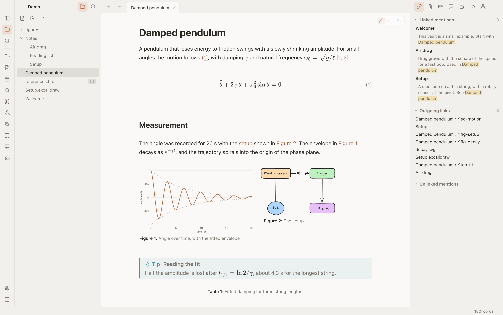

# Pumice

A local-first, extensible markdown note-taking app. Notes are plain files in a folder; the
editor, file explorer, search, backlinks, Excalidraw — everything — is a plugin built on the same
public API third-party plugins use. Reads and writes Obsidian vaults, links notes by stable ID
(`[[id|Name]]`) so renames never break links, and supports real-time collaboration through a
self-hostable server. See [docs/plan](docs/plan/README.md) for the architecture and roadmap.



## What it does

- **Writing**: live preview where everything is drawn in place and only what the cursor is at
  shows as source; a read mode and a source mode; tables as grids; lists that keep their
  numbers in order; find and replace; spell checking; optional Vim keys.
- **Papers and reports**: LaTeX formulas with a preview while typing; figures, tables and
  equations that number themselves, with labels (`{#fig-loss}`) and references (`@fig-loss`);
  citations from BibTeX files (`@doe2020`, `[@doe2020, p. 3]`) with a reference list; figures
  side by side, resized and rearranged by dragging; export to a single web page or a PDF;
  a note presented as slides.
- **Linking**: `[[links]]` that follow renames, backlinks, outline, tags, properties, graph,
  full-text search, daily notes, templates.
- **More than text**: Excalidraw drawings (with LaTeX), PDFs with highlights and notes, images,
  audio and video, and frames: HTML visualizations shown in notes with settings and data.
- **Assistant** (desktop): a chat beside the note, on your own ChatGPT plan or with Claude Code,
  Codex or Gemini CLI. It reads and edits notes with your approval, answers comments, searches
  the web, and draws and changes Excalidraw drawings while looking at how they turn out.
- **Together**: real-time collaboration with presence, history and roles through a server you
  can host yourself.
- **Yours**: plain files in a folder, Obsidian-compatible, and every feature a plugin that can
  be switched off or replaced.

## Install

macOS (Apple Silicon and Intel), with [Homebrew](https://brew.sh):

```sh
brew install --cask doeringchristian/pumice/pumice
```

The app is not signed with an Apple Developer certificate; the cask clears macOS's quarantine
flag so it opens normally. Update with `brew upgrade pumice`. Android: download the APK from the
[latest release](https://github.com/DoeringChristian/pumice/releases/latest). Other platforms:
build from source (below).

In a browser: the web app opens vaults shared through a [collaboration server](#collaboration-server).
Sign in to the server, then open, join or create a vault. The vault is kept in the browser (IndexedDB)
and synced, so edits made while the server is away are sent when it is back. One tab holds a vault
at a time. Each release publishes the app to GitHub Pages; `npm run build -w @pumice/web` makes a
folder to host anywhere (`apps/web/dist`). A page served over https can only use a server with https.

On first start Pumice shows its vault selector: create a vault, or open any folder as one
(including an existing Obsidian vault). After that it reopens the last vault. Switch vaults with
the vault name at the top of the sidebar or **⌘/Ctrl+Shift+O**; "Manage vaults…" (also in the
File menu) brings the selector back.

## Getting started

Requires Node ≥ 22.5 (24 recommended), with the npm that comes with it.

```sh
git submodule update --init   # vendor/excalidraw: our Excalidraw fork with LaTeX
npm install
npm run build:excalidraw     # builds the fork once (a few minutes; again after updating it)
npm test                     # unit + integration tests (parsers, index, links, collaboration, plugins…)
npm run typecheck
npm run dev:web              # the web app → http://localhost:5199 (#demo: an in-memory demo vault)
npm run dev:desktop          # Electron app; asks for a vault folder (or set PUMICE_VAULT=/path)
npm run screenshot           # the README's screenshot from the demo vault (docs/demo); --phone: as on Android
```

In the demo vault, `window.pumice` exposes the kernel and the in-memory file system
(`pumice.platform.fs.external.write(path, text)` simulates an edit by another program;
`pumice.reset()` restores the sample vault).

### Collaboration server

```sh
npm run serve -- ~/notes         # serve a folder as a shared vault, http://localhost:8787
cd apps/server
PUMICE_DEV_LOGIN=1 npm start     # or a server for vaults shared from the app, data in ./data
docker compose up                # or: the Docker image with a data volume
```

Serving a folder: what is written into it (by hand, a program, an agent) reaches everyone in
the vault, and what they edit is written into it; what they delete goes into its `.trash`. The
server keeps its data in `~/.local/share/pumice-server` (`PUMICE_DATA`) and prints the vault's link on start. The
server also serves the web app: opening its address (or the invite link) in a browser is Pumice,
using that server.

`PUMICE_DEV_LOGIN=1` shows login codes in the app instead of emailing them (wire SMTP into
`sendLoginCode` in `apps/server/src/server.ts` for production). In the app: **Settings →
Collaboration** → sign in → **Share this vault**, then create an invite link for others.

### Packaging

```sh
npm run package -w @pumice/desktop          # dmg/zip, nsis, AppImage/deb in apps/desktop/release
npm run ios|android -w @pumice/mobile       # needs Xcode / Android Studio; see apps/mobile/README.md
```

Signing and notarization read `CSC_LINK`, `CSC_KEY_PASSWORD`, `APPLE_ID`,
`APPLE_APP_SPECIFIC_PASSWORD` and `APPLE_TEAM_ID`. Packaged desktop builds update themselves
from GitHub releases (or `PUMICE_UPDATE_URL`).

### Plugins

```sh
npx pumice-plugin init my-plugin --id me.my-plugin
npx pumice-plugin dev my-plugin --vault /path/to/vault   # live reload into the running app
npm run docs:api                                          # API reference → docs/api
```

Start with the [plugin guide](docs/plugins/README.md) and the plugins in `examples/`.

### Electron binary on Node ≥ 25

Electron's postinstall can stop half-way while unzipping on very new Node versions. If
`electron` reports "failed to install correctly", extract the cached zip by hand:

```sh
cd node_modules/electron
rm -rf dist && mkdir dist
ditto -x -k ~/Library/Caches/electron/*/electron-v*-darwin-*.zip dist   # macOS; use unzip elsewhere
printf 'Electron.app/Contents/MacOS/Electron' > path.txt                 # Linux: electron, Windows: electron.exe
```

## Layout

```
packages/
  api/                @pumice/api — the public plugin API (the only package plugins import)
  kernel/             plugin host: manifests, dependencies, lazy activation, enable/disable, hot reload
  markdown/           the dialect: micromark + Lezer extensions, metadata, rendering, frontmatter edits
  markdown-spec/      conformance corpus: both parsers must agree with recorded expectations
  platform/           Platform interfaces (fs, watcher, storage, lifecycle, shell, net)
  platform-memory/    in-memory platform (tests, browser harness)
  platform-electron/  renderer-side platform over the Electron preload bridge
  platform-web/       a vault in the browser's IndexedDB
  platform-capacitor/ iOS/Android platform over the native PumiceFs plugin
  collab-protocol/    versioned wire envelope shared by client and server
  plugin-cli/         pumice-plugin init/build/dev
  ui/                 theme, icons, fuzzy matching, DOM and settings helpers
  app/                boots the kernel with the bundled plugins; community plugin manager
plugins/              core plugins (each replaceable; vault, documents, markdown, workspace required)
  core-vault/ core-vaults/ core-documents/ core-markdown/ core-index/ core-workspace/
  core-editor/ core-reader/ core-links/ core-ids/ core-explorer/ core-files/ core-switcher/
  core-palette/ core-search/ core-backlinks/ core-outline/ core-tags/ core-properties/
  core-graph/ core-tables/ core-bibliography/ core-snippets/ core-vim/ core-excalidraw/
  core-media/ core-pdf/ core-frames/ core-slides/ core-export/ core-comments/ core-agents/
  core-templates/ core-daily/ core-collab/ core-settings/ core-theme/ core-diagnostics/
apps/
  web/                web app: shared vaults in a browser, and a demo vault
  desktop/            Electron shell (+ electron-builder packaging, auto-update)
  mobile/             Capacitor shell + native PumiceFs plugin sources (Swift, Kotlin)
  server/             collaboration server: Yjs sync, accounts, vaults, blobs, history
examples/             example community plugins (word-goal, kbd-syntax)
```

## Since v1 (M7, docs/plan/09)

- **Ribbon**: plugins add buttons (`workspace.registerRibbonAction`): new note, daily note, quick
  switcher, command palette, graph, new drawing, templates, agent chat.
- **Tables**: in live preview a table is a grid — type in cells, Tab/Enter/arrows to move, handles
  for insert/move/delete/align/sort, `+` bars to add rows and columns. `Mod+Alt+T` inserts one.
- **Comments**: select text and click the comment button next to it (or `Mod+Alt+M`); the comment
  is written right there. Stored in `.pumice/comments/<note path>.json`, not in the markdown; they
  follow their text through edits. A comment or reply with `@agent` (or `@claude`, `@chatgpt`,
  `@codex`, `@gemini`) is answered by that agent in the thread, and it can edit the note.
  A new comment starts addressed to the agent you last wrote to (Settings → Comments).
- **Side by side**: several embeds on one line (`![[a.png]] ![[b.png]]`, also videos, frames and
  notes) stand beside each other; those with a width keep it and the others share the rest.
- **Drag and drop**: drag a file from the file list into a note to embed it (a note is linked).
  A file that a frame can show becomes a `frame` block, asking which frame if several can; a
  dropped frame asks which files it should show (several, for a frame that compares). Files
  dragged in from outside go to the attachments folder, or into the folder of the file list
  they are dropped on; a picture dragged from a web page is saved the same way.
- **Right-click an embed** (picture, video, frame) to open it, copy it (as a picture or as
  its text), or remove it from the note. Removing does not ask: only the reference goes, and
  undo brings it back. Selecting across embeds selects them like text.
- **Moving figures**: drag a picture, video or drawing to another place in the note; dropped
  on the left or right third of another figure it goes beside it. In a row, resizing one
  figure gives the others the rest of the width, and snaps where two are equally high.
- **Web resources in frames**: a setting written `"[label](https://…)"` or `<https://…>` refers
  to a file on the web the same way `"[label](file)"` refers to one in the vault.
- **Sizing embeds**: an embedded picture, video or frame has a handle in its bottom-right corner;
  dragging it writes the size into the note (`![[pic.png]]{width=50%}`, or `width:`/`height:` in a frame
  block; Obsidian's `![[pic.png|300]]` is still read).
- **Completion while typing**: after ``` the language (choosing one closes the block; `frame`
  starts a frame block); inside a frame block the frames of the vault, the settings a frame
  documents in its `frame.json` with their values, and the files it takes; in math, LaTeX
  commands after `\\` and environments after `\\begin{`. Enter after an opening ``` or `$$`
  closes the block, and `$` closes like a quote. Plugins add their own suggestions through
  `editorCompletions`.
- **Captions, numbering and references**: a figure's caption is the alias of its embed
  (`![[loss.png|Loss over time]]{#fig-loss width=50%}`, or `{…}`) or the `caption:` of a frame block; a table's is a
  `Table: …` line above it. A label is written as pandoc does: `{#fig-loss}` right behind an
  embed, `{#tab-runs}` at the end of the `Table: …` line, `{#eq-energy}` behind the `$$` that
  closes a formula (or on the line after it), `label: fig-setup` in a frame block (Obsidian's `^fig-loss` is still read).
  Figures, tables and equations are numbered in the order of the note, and `@fig-loss` or
  `[[#^fig-loss]]` reads "Figure 2" (from another note, `[[Results#^fig-loss]]` reads "Figure 2
  in Results"). Typing `@` suggests what can be referred to, by number, label or caption; a
  label is renamed in place, and the references follow. A click on a reference goes to its
  target and flashes it.
- **Bibliography**: `@doe2020` and `[@doe2020, p. 3; @roe2021]` cite from a BibTeX file, as
  numbers or as author and year, with the list of references at the end of the note. The file
  is the note's `bibliography:` property, the one chosen in Settings → Bibliography (which can
  also create one or copy one in), or the `.bib` files at the top of the vault.
- **Table of contents**: a `toc` block (settings `title`, `depth`, `numbered`, and
  `from: all | below`), or a line that says `[TOC]`, shows the note's headings as links, kept
  current as they change and exported as links.
- **Find and replace** (`Mod+F`): a card with the number of matches, match case, whole words
  and regular expressions. A match inside something drawn (a formula, a link, a table) shows
  as the source it was found in.
- **Lists**: Enter on an empty item ends the list; numbered lists renumber as items are added,
  removed or set in; a long item wraps under its own text.
- **Read, write, source**: three ways to show a note, switched at its top right. Reading shows
  it as writing does, with nothing that can be changed.
- **Slides and export**: "Present this note as slides" starts a new slide at each `---`;
  "Export" writes the note as one web page that needs nothing else, or as a PDF, laid out as
  the note is.
- **Vim mode** (off until switched on in the settings): normal, insert and visual modes, with keys to switch
  files, search the vault and leap to a place on screen.
- **Drawings for the assistant**: the built-in assistant lists what is in an Excalidraw
  drawing and changes it by adding, updating and deleting shapes, texts (also LaTeX) and
  arrows. Arrows between shapes route themselves, at right angles by default, and a whole
  diagram can be arranged as a flowchart, downwards or to the right. After each step the
  assistant is shown a picture of the result.
- **Editing rendered things**: a list keeps its dots on the line being edited (the dash shows
  when the cursor is at it). A click on a formula puts the cursor at the symbol clicked; while
  a formula is written, what it gives is shown under it, and a formula with a mistake is drawn
  as far as it is right, the wrong part in red. Code blocks show their language and a copy
  button in place of their fences. A click on a picture enlarges it; the `</>` button on a
  picture or frame shows its source. Rows and columns of a table are moved by dragging their
  handles. Rendered things show a faint outline on hover.
- **Tables end at text**: a line right under a table that has no `|` is a paragraph, not one
  more row (unlike standard Markdown, where a blank line is needed; Obsidian shows such a line
  as a row).
- **Snippets**: `:today:`, `:now:`, `:time:`, `:tomorrow:`, `:daily:` and your own (Settings →
  Snippets) are replaced as the closing colon is typed.
- **Back and forward**: arrows in the tab bar, `Mod+Alt+←/→` and the mouse's back/forward buttons
  move through what a tab has shown.
- **Media**: images (including SVG), audio and video open in a tab, with zoom for images;
  double-click an embedded image to open it.
- **Plotly figures**: a figure saved by Plotly (`fig.write_json("loss.plotly.json")`) is shown
  where a note embeds it, `![[loss.plotly.json|Loss over time]]{#fig-loss width=60%}`, in the
  app's colours and as wide as its box; exports show it as a picture. Its data stays in its file:
  a note never holds it.
- **Frames**: HTML files (visualizations, interactive figures, small tools) shown inside notes.
  `![[frames/bars/index.html]]` shows one; a `frame` block passes settings and data files to it,
  so one HTML file serves many notes and the note itself stays small:

  ````markdown
  ```frame
  file: frames/field/index.html
  caption: Pressure field, run 12
  data: "[run 12](runs/field-12.json)"
  colormap: viridis
  ```
  ````

  `file`, `caption` and `height` are reserved; every other key is the file's own setting, and a
  value that is one quoted Markdown link arrives as a URL the page can fetch. The page gets the app's theme
  (CSS variables, base styles, light/dark) and `window.pumice.settings`; the settings are also
  the JSON in the URL fragment, so a frame runs without Pumice too. Frames are sandboxed: they
  see their own folder and the files passed to them, not the vault, the app or (unless allowed
  in Settings → Frames) the network. They reload when their files change. The assistant is told
  how frames work and to follow `frames/README.md`, the style guide written by "Frames: write
  the style guide".

- **Adding to a frame**: drag a file from the file list onto a frame and it is added to what the
  frame shows (its `frame.json` says which types it takes, and whether several); the block in
  the note is rewritten, an embed becomes a block. A frame can change its own settings with
  `pumice.update({ … })` (remove an item, reorder, pick a colormap): they are written to the
  note too, without reloading the frame. A frame cannot name files it was not given.
- **Frames as viewers**: a frame with a `frame.json` beside its `index.html`
  (`{"name": "Mesh viewer", "opens": {"extensions": ["ply", "obj"], "setting": "mesh"}}`) opens
  files of those types in a tab. The app's own views stay the default for their types; with
  several viewers and no default the app asks once and remembers the answer per file type.
  "Open with…" (tab and file menus, the viewer's bar, the command palette) switches.
- **PDF annotator**: PDFs open in a tab. Select text to highlight it, add notes, list the
  highlights, and copy a quote with a link (`[[paper.pdf#page=3]]` opens that page). Annotations
  are kept in `.pumice/annotations/<pdf path>.json`, the PDF is never changed; highlights made
  with Obsidian's "PDF Annotator" plugin are taken over on first open.
- **Copy location**: `Mod+Alt+C` copies `path:line` for pasting into an agent; also "with text"
  and "link to block" in the right-click menu. The pin beside a selection copies where it
  begins and what it says: `Notes/Plan.md:12:8 "the selected text"`.
- **Assistant** (desktop): a chat in the right sidebar. Built in: **ChatGPT on your own plan**
  through OpenAI's "Sign in with ChatGPT" (nothing to install; it can search, read and, with your
  approval, edit notes). Also Claude Code, Codex and Gemini CLI through the Agent Client Protocol
  if you have them. `Mod+Alt+A` asks about the selection.
- **Chats are kept**: every conversation is saved in `.pumice/chats/` as it goes. The clock
  button in the chat lists earlier chats; picking one shows it and continues it (the built-in
  assistant from its saved state, the other agents by asking them to load their session; an
  agent that cannot is started fresh below the old messages). The built-in assistant reopens
  its last chat when the app starts.
- **Web access** for the built-in assistant: it can search the web (DuckDuckGo) and read pages.
  It can also download a file (a library, a dataset, a model) into the vault. It asks before
  the first page of a website is opened (once, per chat, or never again), never opens local
  addresses, and can be switched off in Settings → Agents.
- **Write while the agent works**: a message sent while the agent is busy waits in a queue above
  the input and goes out when the agent is done; `Mod+Enter` stops the agent and sends it now.
- **Reply to a passage**: select part of an answer in the chat and click "Reply"; the passage is
  quoted in your next message.
- **Slash commands** in the chat: type `/` for the agent's own commands (for example `/compact`);
  the built-in assistant has `/compact`, `/clear` and `/help`, and `/new` starts a new chat.
- **Files**: paste or drop images and files into a note; they go to the attachment folder set
  in Settings → Files (vault folder, a fixed folder, next to the note, or a subfolder), with a
  separate default folder for new drawings. Unset, both follow the vault's Obsidian settings.
- **LaTeX in drawings**: Excalidraw is built from our fork (`vendor/excalidraw`, upstream master +
  the MathJax subtypes PR #6037/#6936). Select a text, switch on "Math (LaTeX)" in its style panel and write `$…$`.

## Status

All milestones of the [roadmap](docs/plan/08-roadmap.md) are implemented; what was verified, and
how, is listed per milestone. Known gaps are at the end.

- **M0 Foundations, M1 Editing core** — kernel, platforms, vault, Yjs documents with three-way
  merge of external edits (fuzz-tested), workspace, editor with live preview, explorer,
  switcher, palette.
- **M2 Linking & knowledge** — full Obsidian dialect in both parsers (conformance corpus green),
  Obsidian-style `[[Name]]` links with a suggester and link updates on rename (note IDs and
  `[[id|Name]]` links are an optional plugin on top),
  metadata index in a worker (10k notes: 3.1 s cold, 77 ms warm; 50k: 17 s cold, 0.4 s warm),
  backlinks with unlinked mentions, outline, tags, properties, full-text search with filters,
  reading view, embeds (notes, sections, blocks, images, audio, video, PDF), callouts, KaTeX
  math, Mermaid. Decision D13: in-memory index instead of SQLite-WASM.
- **M3 Excalidraw** — `.excalidraw` (new drawings) and `.excalidraw.md` (Obsidian) files, element-level CRDT
  codec with byte-identical saves of untouched drawings, embeds as SVG, links and search,
  external-edit merging, export, offline fonts.
- **M4 Ecosystem** — community plugins (install from files/URL, enable/disable, hot reload),
  shared modules (one CodeMirror/React/Yjs), `pumice-plugin` CLI, guide and TypeDoc reference,
  examples, templates, daily notes, graph view (global and local), themes and CSS snippets,
  tabbed settings with plugin tabs.
- **M5 Collaboration** — server (Node, `node:sqlite`, WebSocket Yjs sync + awareness, roles,
  invites, blobs, snapshots/history, crash reports), shared vaults with full replicas projected
  to plain files, offline edits merged on reconnect, presence and remote cursors, viewer role
  read-only, version history restore. Decision D14: server-trusted first, E2EE later.
- **M6 Beta hardening** — 50k-note benchmark, Obsidian compatibility report, accessibility pass
  (tree keyboard navigation, ARIA states, reduced motion), electron-builder packaging and
  auto-update, opt-in crash reporting, CI packaging matrix.
- **Mobile** — Capacitor shell, `platform-capacitor`, native `PumiceFs` (Swift/Kotlin), phone
  layout with drawers and bottom bar, editor toolbar above the keyboard. The web part builds and
  the phone layout was checked in a 390 px viewport.

### Known gaps

- Android: each release carries a debug APK, built but little used. iOS has not been built or
  run. App Store / Play submission is not done.
- Desktop builds are unsigned. macOS builds are released and used; Windows and Linux packages
  are built in CI but have not been run.
- Login emails need an SMTP hook on the server; OIDC sign-in is not implemented.
- End-to-end encryption (D14) and partial replicas are post-beta.
- Not yet: hover previews, `.canvas` files, Excalidraw collaborator pointers, typing `[[` inside
  drawings, a configurable ID property name, syncing `.pumice/` configuration in shared vaults.
- The index snapshot for 50k notes is ~73 MB of JSON; fine on desktop, too large for the web
  harness's storage.
